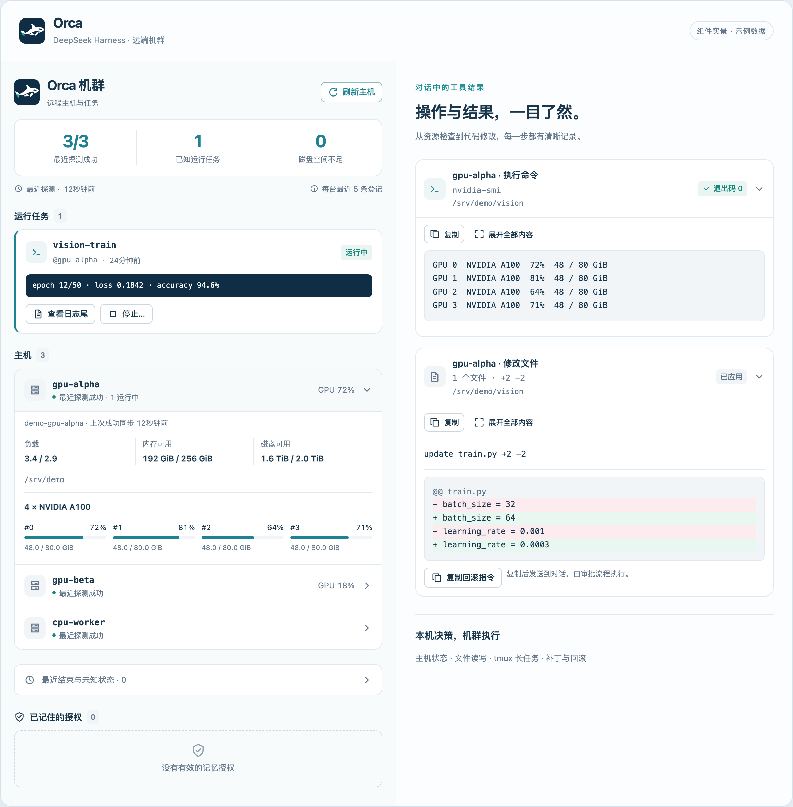
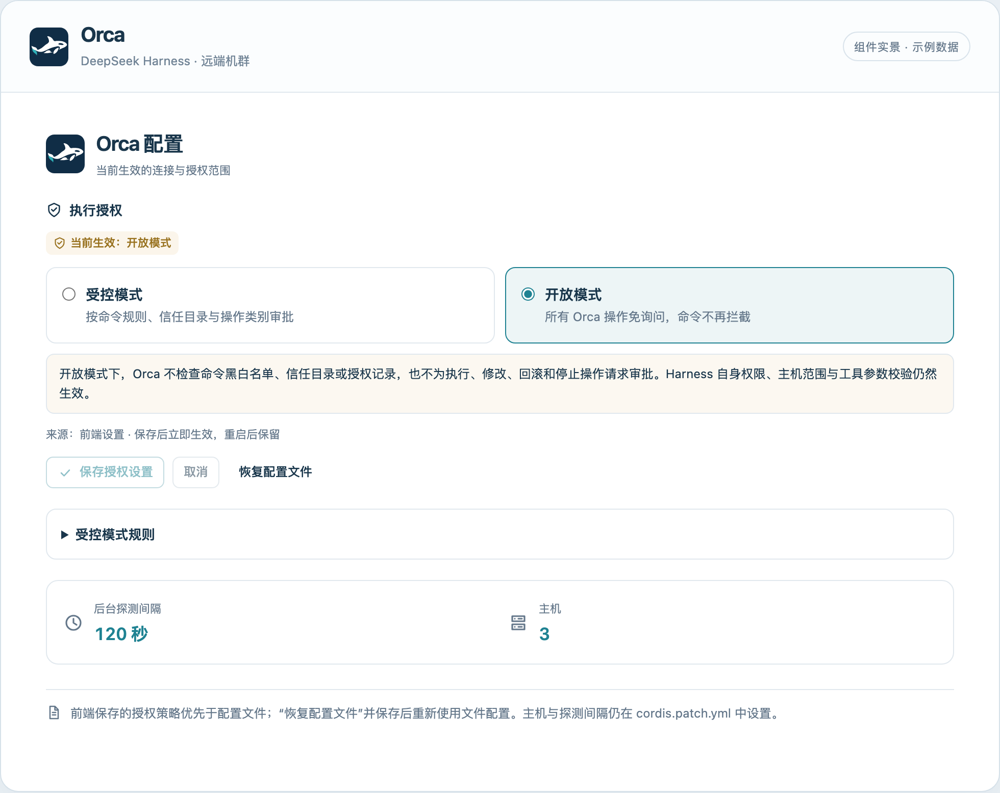

<div align="center">
  
  <h1>Orca</h1>
  <p><strong>本机决策，机群执行。</strong></p>
  <p>DeepSeek Harness 原生 SSH 机群插件<br>在对话中检查主机、读写文件、运行任务，并查看每一步的结果。</p>
  <p>
    <a href="#快速开始">快速开始</a> ·
    <a href="#界面预览">界面预览</a> ·
    <a href="#授权模式">授权模式</a> ·
    <a href="./docs/panel.md">使用文档</a> ·
    <a href="./LICENSE">MIT License</a>
  </p>
  <p><code>10 个原生工具</code> &nbsp; <code>SSH + tmux</code> &nbsp; <code>中英双语</code></p>
</div>

---

Orca 将远程操作接入 DeepSeek Harness 的工具、审批和侧栏体系。你可以在本机对话中完成资源检查、代码修改和任务管理，由已配置的 SSH 主机执行操作，无需迁移工作区。

## 界面预览



<p align="center"><sub>机群面板与工具卡片的组合演示。截图直接渲染项目组件，所有主机、路径、任务和指标均为虚构示例；不含个人账号或实际运行环境信息。</sub></p>

| 能力 | 使用体验 |
| --- | --- |
| **机群总览** | 集中查看主机连接状态、GPU、内存、磁盘与最近登记任务；展开即可查看资源明细。 |
| **原生工具卡片** | 命令输出、文件行号、搜索结果、diff 与冲突分开展示，支持展开和复制。 |
| **长任务管理** | 用 tmux 启动任务，记录状态与结构化日志；按需查看日志尾，确认后停止登记任务。 |
| **补丁与回滚** | 修改前预检，校验上次读取的文件哈希；记录备份与 patch ID，支持冲突反馈和回滚。 |
| **可视化授权** | 编辑命令规则、信任目录、审批方式和授权期限，也可切换为开放模式。 |

## 快速开始

### 1. 准备环境

| 位置 | 要求 |
| --- | --- |
| 本机 | DeepSeek Harness、Node.js ≥ 22、Python 3、OpenSSH 客户端。 |
| 远端 | 可通过 SSH 访问的 Linux 主机，具备 Bash 与 Python 3；长任务需要 tmux，GPU 指标需要 `nvidia-smi`。 |
| SSH 配置 | 使用 `~/.ssh/config` 中的具体 Host 别名，先确认终端可以无交互连接。 |

远端执行逻辑使用 Python 标准库，无需部署独立的 Orca 常驻服务。

以下使用虚构别名 `gpu-alpha`。先换成自己的 SSH 别名并检查连接：

```bash
ssh -o BatchMode=yes gpu-alpha 'python3 --version'
```

### 2. 安装插件

```bash
git clone https://github.com/Becomingw/dsh-orca.git ~/plugins/dsh-orca
```

然后在 **DSH 会话**中发送：

```text
请安装本地插件 ~/plugins/dsh-orca
```

由 DSH 插件管理器完成 bundle 安装。安装或更新后重启 DSH，以加载宿主工具和前端组件；无需单独启动前端开发服务器。

### 3. 打开并使用

1. 打开一个 DSH 会话，点击顶栏 **机群**，在右侧栏查看主机与任务。
2. 进入 **设置 → Orca 配置 → 执行授权**，选择模式或编辑规则，再点击 **保存授权设置**。
3. 在对话中描述需要完成的远程操作。

例如，替换下列示例主机和路径后发送：

```text
查看 gpu-alpha 的 GPU、内存和磁盘状态。
```

```text
读取 gpu-alpha 上 /srv/demo/vision/train.py 的前 120 行，
把 batch_size 从 32 改为 64，先展示补丁预检结果。
```

```text
在 gpu-alpha 的 /srv/demo/vision 中用 tmux 启动 python3 train.py，
会话名为 vision-train，日志写入 /srv/demo/logs/train.log。
```

<details>
<summary><strong>更新已安装的本地插件</strong></summary>

在本地修改已妥善保存后，拉取更新并重启 DSH：

```bash
git -C ~/plugins/dsh-orca pull --ff-only
```

本文描述仓库当前代码的功能；使用特定发行标签时，请以该标签内的文档为准。

</details>

## 授权模式

**默认使用受控模式。** 授权策略可以直接在前端修改，无需每次编辑配置文件。

| | 受控模式 | 开放模式 |
| --- | --- | --- |
| 命令规则 | 检查拦截列表与免询问规则 | Orca 不过滤命令 |
| 操作审批 | 按操作类别询问，或使用已记住的授权 | Orca 不再额外请求审批 |
| 信任目录 | 范围外的写操作需要审批 | Orca 不检查信任目录 |
| 适用选择 | 需要明确控制命令和授权范围 | 希望由 Harness 自身权限统一决定执行 |



<p align="center"><sub>开放模式的示例状态。实际安装默认受控；选中模式只是草稿，保存后才生效。</sub></p>

展开 **受控模式规则**，可以编辑：

- **命令规则**：每行一条 glob，支持 `*` 和 `?`；拦截规则优先。免询问规则用于 `run`，拦截规则同时用于 `run` 和 `launch`。
- **信任目录**：每行一个绝对路径或 glob；留空表示不限制目录范围。
- **审批方式**：免询问、首次询问并记住、每次询问。受控模式下，停止任务固定为每次询问。
- **记忆期限**：1–90 天，默认 7 天，仅影响新授权。授权按“主机 + 目录 + 操作类别”记录，可在机群面板撤销。

保存后，后续工具调用立即使用新策略，重启后保留。前端设置优先于配置文件中的 `policy`；点击 **恢复配置文件**并保存，可重新使用文件配置。模式切换保留受控规则，不取消已经执行或等待审批的调用。

> 开放模式只关闭 Orca 自身的命令过滤和额外审批。Harness 自身权限、配置的主机范围、工具参数校验、补丁冲突检测与任务身份校验仍然生效。
>
> 受控模式下，Harness 的 `approval: never` 表示不发起审批：需要审批的操作会被拒绝。它不等同于 Orca 的开放模式。

完整判定规则与存储说明见 [授权策略文档](./docs/policy.md)。

## 工具一览

以下审批行为均指**受控模式的默认策略**；命令规则、目录范围与已有授权会参与最终判定。

| 工具 | 用途 | 默认审批 |
| --- | --- | --- |
| `orca_status` | 主机资源、GPU、tmux 与登记任务 | 免询问 |
| `orca_read` | 分页读取远端文件 | 免询问 |
| `orca_grep` | 服务端搜索，支持上下文与 `.gz` 文件 | 免询问 |
| `orca_ls` | 列出目录与文件 | 免询问 |
| `orca_run` | 执行有时间与输出上限的命令 | 首次询问并记住 |
| `orca_launch` | 启动 tmux 长任务并记录日志 | 首次询问并记住 |
| `orca_patch` | 预检与应用补丁，记录备份 | 每次询问；`dry_run` 免询问 |
| `orca_rollback` | 按 patch ID 回滚 | 每次询问 |
| `orca_stop` | 停止登记任务，宽限后按需强制结束 | 每次询问 |
| `orca_grants` | 列出或撤销记忆授权 | 免询问 |

## 连接与探测配置

日常授权设置使用前端即可。**主机范围、Python 路径、后台探测间隔**仍在当前 profile 的 `cordis.patch.yml` 中配置。

| 配置 | 默认行为 |
| --- | --- |
| `hosts: []` | 工具允许使用 SSH 配置中的具体别名；面板自动发现并监控最多 12 台。显式配置后，工具限于该列表，面板监控这些主机。 |
| `panel.pollSeconds: 120` | 宿主每 120 秒探测一次；设为 `0` 关闭后台探测，仍可手动刷新。 |
| `panel.jobLimit: 5` | 每台主机读取最近 5 条任务登记。 |
| `python: python3` | 本机用于启动引擎的 Python 命令。 |

<details>
<summary><strong>展开完整的 profile 覆盖示例</strong></summary>

`- id: orca` 覆盖会**替换整个 config**，不是深度合并。请复制当前配置后修改，保留需要的字段。下面的别名和路径均为示例：

```yaml
- id: orca
  name: dsh-orca
  config:
    hosts: [gpu-alpha, gpu-beta]
    python: python3
    policy:
      mode: controlled
      autoAllow: [status, read, grep, ls, grants]
      askOnce: [run, launch]
      alwaysAsk: [patch, rollback, stop]
      grantTtlDays: 7
      allowedCommands:
        - nvidia-smi
        - nvidia-smi *
        - git status
        - git log *
        - git diff *
        - ls *
        - tail *
        - df -h *
      deniedCommands:
        - rm -rf /*
        - sudo *
        - shutdown*
        - reboot*
        - mkfs*
        - kill -9 -1*
      trustedWorkdirs: [/srv/demo/*]
    panel:
      pollSeconds: 120
      jobLimit: 5
```

修改文件配置后重启 DSH。如果已在前端保存授权覆盖，需先在前端选择 **恢复配置文件**并保存，文件中的 `policy` 才会重新成为生效来源。

前端授权覆盖与记忆授权默认位于 `$DSH_HOME/storages/orca/`（未设置 `DSH_HOME` 时使用 `~/.dsh`）。多个 profile 需要隔离策略时，分别设置独立的 `policyPath` 和 `grantsPath`。详见 [授权策略文档](./docs/policy.md)。

</details>

## 数据与执行边界

- **面板是缓存视图。** 打开面板本身不触发 SSH；宿主定期探测，点击刷新可主动更新。失败时保留最后成功的数据并标记过期。
- **任务数是已知数量。** 面板只覆盖最近登记记录；统计不完整时显示 `+`。零任务不代表整台主机空闲，也不展示所有用户进程。
- **日志尾按需读取。** 普通命令执行期间没有流式输出；长任务使用 tmux 和结构化日志查看进展。
- **停止针对登记任务。** 面板停止前需要确认，并复核任务身份；过期记录不能直接停止。
- **补丁可能发生冲突。** 写入前检查文件状态，失败结果会报告冲突、恢复或部分应用状态；需要根据结果处理，不能假定所有失败都已自动恢复。

## 开发与测试

本仓库使用原生 JavaScript 与 Python。运行测试需要 Node.js ≥ 22、Python 3、pytest 和本机 tmux；远端执行测试通过隔离的假 SSH 与 tmux socket 运行。

```bash
# 安装测试依赖到独立环境
python3 -m venv .venv
source .venv/bin/activate
python -m pip install pytest

# JavaScript + Python 测试
npm test
```

<details>
<summary><strong>测试覆盖与可选交叉验证</strong></summary>

| 测试范围 | 内容 |
| --- | --- |
| `test/` | 工具注册、策略与 guard、配置持久化、接口校验、缓存和引擎桥接。 |
| `tests/test_orca_ext.py` | 日志跟随器、grep、ls 与扩展处理器。 |
| `tests/test_orca_patch_*.py` | 补丁语义、冲突、回滚、崩溃恢复与并发写入。 |
| `tests/test_codex_scenarios.py` | 复刻的 Codex apply-patch 场景。 |
| `tests/test_contract.py` | 与 remote-fleet 的任务协议互通。 |
| `tests/test_upstream_engine.py` / `tests/test_orca_engine.py` | 冻结引擎与 Orca 引擎回归。 |

可选环境变量：

- `ORCA_DSH_TOOLS`：指向 `@deepseek-ai/dsh-tools/lib/index.js`，使用宿主校验器检查工具 schema。
- `ORCA_CODEX_BIN`：指向本机 Codex 可执行文件，启用补丁结果的交叉对照。
- `ORCA_UPSTREAM_ENGINE`：指向 remote-fleet 的 `scripts/remote_fleet_mcp.py`，启用协议契约测试；也会尝试相邻的 `../remote-fleet`。

缺少可选依赖时，相应测试会跳过；以测试输出为准。

</details>

<details>
<summary><strong>项目结构</strong></summary>

```text
dsh-orca/
├── index.js                # 宿主入口、工具注册与审批接线
├── client.js               # 原生工具卡片、机群侧栏、可编辑设置
├── cordis.patch.yml        # bundle 默认配置
├── lib/
│   ├── engine.js           # Python 引擎桥与取消处理
│   ├── tools.js            # 工具 schema 与模型输出
│   ├── policy.js           # 受控 / 开放模式判定
│   ├── settings.js         # 授权覆盖的校验与持久化
│   ├── grants.js           # 记忆授权
│   ├── cache.js            # 机群状态缓存
│   └── routes.js           # 经过宿主鉴权的前端接口
├── engine/                 # SSH、任务、日志、文件与补丁执行
├── test/                   # JavaScript 测试
├── tests/                  # Python 测试与场景夹具
└── docs/                   # 设计说明、操作文档与示例截图
```

</details>

## 文档导航

| 想了解什么 | 从这里开始 |
| --- | --- |
| 面板交互、数据口径与接口 | [前端与机群面板](./docs/panel.md) |
| 授权规则、开放模式与存储 | [授权策略](./docs/policy.md) |
| 日志如何记录、轮转和读取 | [结构化日志](./docs/logging.md) |
| 组件和数据流 | [架构](./docs/architecture.md) · [工具命名](./docs/naming.md) |
| 前端设计与实现约定 | [UI 设计](./docs/ui-design.md) |
| 上游协议与同步方式 | [兼容性](./docs/compatibility.md) · [引擎改动](./docs/engine-changes.md) · [同步流程](./docs/upstream.md) |
| 后续计划与里程碑 | [路线图](./docs/roadmap.md) |

## 来源与许可证

Orca 的执行引擎派生自 **remote-fleet v0.7.0**，以 DSH 原生工具提供能力，并在本仓库独立演进。冻结点见 [UPSTREAM.md](./UPSTREAM.md)，协议差异见 [兼容性文档](./docs/compatibility.md)。

本项目采用 [MIT License](./LICENSE)。第三方来源与声明见 [NOTICE](./NOTICE)；Codex 测试场景的 Apache-2.0 声明保留在 [场景 NOTICE](./tests/fixtures/codex_scenarios/NOTICE) 中。
